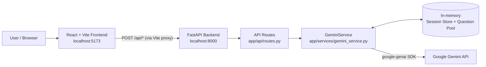
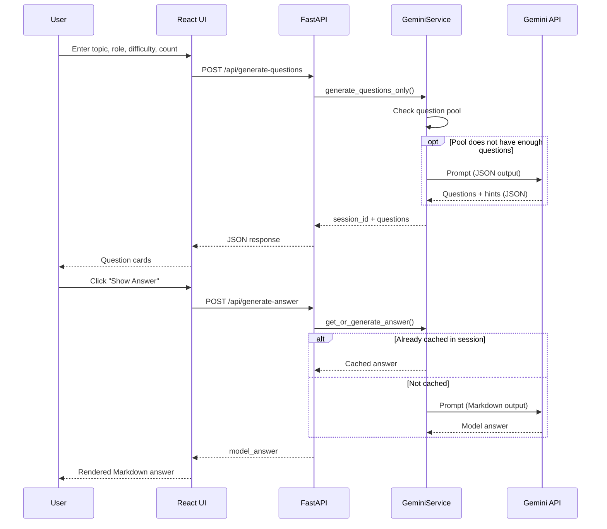

# AI Interview Generator (AI PrepPulse)

> Generate tailored technical interview questions with Google Gemini, then reveal model answers and code examples on demand.


> **Naming note:** The repository folder is `ai-interview-generator`. The web app calls itself **AI PrepPulse** in the navbar, and the API is titled **AI Interview Question Generator API**.

---

## Table of Contents

1. [Project Overview](#project-overview)
2. [Features](#features)
3. [Tech Stack](#tech-stack)
4. [Project Architecture](#project-architecture)
5. [Folder Structure](#folder-structure)
6. [Installation](#installation)
7. [Environment Variables](#environment-variables)
8. [API Documentation](#api-documentation)
9. [Application Workflow](#application-workflow)
10. [AI Integration](#ai-integration)
11. [Important Dependencies](#important-dependencies)
12. [Screenshots](#screenshots)
13. [Future Improvements](#future-improvements)
14. [Troubleshooting](#troubleshooting)
15. [Author](#author)

---

## Project Overview

**What it does**
This is a full-stack web app that uses Google's Gemini models to create technical interview questions. You choose a topic, a target job role, a difficulty level, and how many questions you want (1–30). The app returns a list of questions, each with a short hint. For any question, you can then ask for a **model answer** or a **code example**.

**Main objective**
Give people a fast way to practise technical interviews on any topic, without writing questions by hand.

**Problem it solves**
Preparing good, relevant interview questions takes time. This app creates questions matched to a topic, role, and difficulty level in seconds. Answers and code are generated only when requested, so the first response stays fast.

**Intended users**
The code does not state its intended users explicitly. Based on the UI text ("Tailored Technical Interview Generator") and the role options, it appears to suit:

- Job seekers preparing for technical interviews
- Interviewers or hiring teams who want question ideas

---

## Features

### Implemented Features

| Area | Feature |
|------|---------|
| Question generation | Generate 1–30 interview questions for a topic, role, and difficulty |
| Inputs | Free-text topic with quick-select chips (`Python`, `DSA`, `SQL`, `System Design`, `ML`) |
| Inputs | Target role dropdown: General Software Engineer, Backend Developer, Frontend Engineer, Machine Learning Engineer, Full Stack Developer |
| Inputs | Difficulty toggle: Beginner, Intermediate, Advanced |
| Hints | Every question comes with a brief hint |
| On-demand answers | "Show Answer" generates a model answer, rendered as Markdown (GitHub-flavoured, via `react-markdown` + `remark-gfm`) |
| On-demand code | "Show Code Example" generates a code snippet shown in a code block |
| Caching | Answers and code are cached per question for the session, so repeat clicks do not call Gemini again |
| Question pool | Extra questions generated in a batch are stored in memory and reused for later requests with the same topic, role, and difficulty |
| Model fallback | If a Gemini model is unavailable, the backend tries the next model in a priority list |
| Copy tools | Copy a single question, or **Copy All** questions to the clipboard |
| Session controls | **New Session** (navbar) and **Refresh** (results bar) clear the current results |
| UX states | Loading spinner, per-card loading states, and error messages |
| API basics | Health-check endpoint, CORS configuration, request validation with Pydantic |

### Planned / Future Features

No `TODO`, `FIXME`, or "planned" comments exist in the code, so a roadmap **could not be determined from the code**. See [Future Improvements](#future-improvements) for suggestions based on the current implementation.

---

## Tech Stack

| Category | Technology |
|----------|------------|
| Frontend framework | React 18 |
| Frontend language | JavaScript (JSX) |
| Build tool / dev server | Vite 5 with `@vitejs/plugin-react` |
| Styling | Plain CSS (`index.css`, `App.css`, `Navbar.css`) — no CSS framework |
| State management | React built-in `useState` hooks (no external state library) |
| Icons | `lucide-react` is listed as a dependency, but it is not imported anywhere in `src/` (the UI uses emoji and inline SVG) |
| Markdown rendering | `react-markdown`, `remark-gfm` |
| Backend framework | FastAPI |
| Backend language | Python (the bundled virtual environment used Python 3.11) |
| ASGI server | Uvicorn |
| Data validation / settings | Pydantic v2, `pydantic-settings`, `python-dotenv` |
| AI / LLM service | Google Gemini via the `google-genai` SDK |
| Database | **None** — all data is held in server memory |
| Authentication | **None** |

---

## Project Architecture

### End-to-end overview

1. **Frontend (React + Vite).** The user fills in a form. `src/services/api.js` sends JSON requests to relative URLs under `/api/...`.
2. **Dev proxy.** In development, Vite proxies `/api` requests to the backend at `http://127.0.0.1:8000` (configured in `vite.config.js`).
3. **Backend (FastAPI).** Routes in `app/api/routes.py` validate the request and call `GeminiService`.
4. **AI integration.** `GeminiService` builds a prompt, calls Gemini (trying fallback models if needed), and parses the response.
5. **In-memory storage.** The service keeps (a) a *session store* so answers and code can be requested later by `session_id` + `question_id`, and (b) a *question pool* of spare questions.
6. **Response.** The backend returns JSON and the frontend updates its state and renders the result.

### Architecture diagram



### Request flow



The "Show Code Example" flow works the same way using `/api/generate-code`.

### Component summary

| Layer | Details |
|-------|---------|
| Frontend | Single-page React app. `App.jsx` holds the form and results state; `QuestionCard.jsx` handles per-question answer/code toggles; `Navbar.jsx` shows branding and the "New Session" button. |
| Backend | FastAPI app with one router mounted at `/api`, plus a `GET /` health check. |
| API communication | JSON over HTTP `POST`. Frontend uses the browser `fetch` API. |
| Database | None. Sessions and the question pool live in Python dictionaries and are **lost when the server restarts**. |
| External services | Google Gemini API only. |

---

## Folder Structure

```text
ai-interview-generator/
├── backend/
│   ├── app/
│   │   ├── __init__.py
│   │   ├── main.py                  # FastAPI app, CORS setup, health check, router mount
│   │   ├── config.py                # Settings loaded from environment / .env
│   │   ├── api/
│   │   │   ├── __init__.py
│   │   │   └── routes.py            # /generate-questions, /generate-answer, /generate-code
│   │   ├── schemas/
│   │   │   ├── __init__.py
│   │   │   └── question.py          # Pydantic request/response models
│   │   └── services/
│   │       ├── __init__.py
│   │       └── gemini_service.py    # Gemini calls, fallback logic, sessions, question pool
│   ├── benchmark_models.py          # Helper script: times a simple call on several models
│   ├── list_models.py               # Helper script: lists available Gemini models
│   ├── test_gemini.py               # Helper script: manual single-call connectivity test
│   ├── requirements.txt             # Python dependencies
│   ├── .env.example                 # Example environment file
│   └── .gitignore
└── frontend/
    ├── index.html                   # HTML entry point
    ├── vite.config.js               # Vite config + /api proxy to the backend
    ├── package.json                 # Frontend dependencies and scripts
    ├── package-lock.json
    ├── .gitignore
    └── src/
        ├── main.jsx                 # React entry point
        ├── App.jsx                  # Main page: form, results, state, API handlers
        ├── App.css                  # Main styles
        ├── index.css                # Global styles
        ├── services/
        │   └── api.js               # fetchQuestions / fetchAnswer / fetchCode
        └── components/
            ├── Navbar.jsx           # Top bar (brand, "Powered by Gemini", New Session, GitHub link)
            ├── Navbar.css
            ├── QuestionCard.jsx     # One question with hint, answer and code toggles
            └── TopicSelector.jsx    # Topic input + chips (currently not used by App.jsx)
```

> The ZIP also contained local-only folders (`backend/venv/`, `frontend/node_modules/`, `.git/`) and `.env` files. These are not part of the source code and should not be committed. Both `.gitignore` files already exclude them.

---

## Installation

### Prerequisites

- **Python 3.11** (the bundled virtual environment used 3.11; `requirements.txt` does not pin a Python version)
- **Node.js and npm** — the project does not pin a version; Vite 5 needs a recent Node.js (18 or newer)
- **Git**
- A **Google Gemini API key** (from [Google AI Studio](https://aistudio.google.com/))

### 1. Clone the repository

The GitHub URL below comes from the link in `Navbar.jsx`. Replace it if your repository lives elsewhere.

```bash
git clone https://github.com/shrutim156/ai-interview-questions-generator.git
cd ai-interview-questions-generator
```

### 2. Backend setup

```bash
cd backend

# Create and activate a virtual environment
python -m venv venv

# Windows (PowerShell / CMD)
venv\Scripts\activate
# macOS / Linux
source venv/bin/activate

# Install dependencies
pip install -r requirements.txt
```

### 3. Configure the backend environment

Copy the example file and add **your own** Gemini API key:

```bash
# Windows
copy .env.example .env
# macOS / Linux
cp .env.example .env
```

Then edit `.env` (see [Environment Variables](#environment-variables)). Make sure `GEMINI_API_KEY` contains your own key.

### 4. Run the backend

From the `backend/` folder, with the virtual environment active:

```bash
uvicorn app.main:app --reload --port 8000
```

The backend runs at `http://127.0.0.1:8000`. Open `http://127.0.0.1:8000/` to see the health-check message. FastAPI's built-in interactive docs are normally available at `http://127.0.0.1:8000/docs`.

> Alternatively, `python -m app.main` also starts the server (it uses `PORT` from the settings, binds to `0.0.0.0`, and enables auto-reload).

### 5. Frontend setup

Open a **second terminal**:

```bash
cd frontend
npm install
```

### 6. Run the frontend

```bash
npm run dev
```

The app runs at `http://localhost:5173`. The Vite dev server forwards `/api` calls to `http://127.0.0.1:8000`, so **the backend must be running on port 8000**.

### Other frontend scripts

| Command | Purpose |
|---------|---------|
| `npm run dev` | Start the development server |
| `npm run build` | Create a production build (`dist/`) |
| `npm run preview` | Preview the production build locally |

> **Production note:** The frontend uses relative `/api/...` URLs and relies on the Vite dev proxy. A production deployment would need a reverse proxy or a configurable API base URL. The code does not include one.

---

## Environment Variables

All environment variables are read by the backend in `backend/app/config.py` (via `pydantic-settings`, from the process environment or a `.env` file).

| Variable | Required | Default | Purpose |
|----------|----------|---------|---------|
| `GEMINI_API_KEY` | **Yes** | — | API key used to authenticate with the Gemini API. The app will not start without it. |
| `ALLOWED_ORIGINS` | No | `http://localhost:5173,http://127.0.0.1:5173` | Comma-separated list of origins allowed by CORS. |
| `PORT` | No | `8000` | Port used when starting the server via `python -m app.main`. |
| `GEMINI_MODEL` | No | `models/gemini-3.6-flash` | Defined in settings, but **not currently used**. The service uses a hard-coded `MODEL_PRIORITY` list instead (see [AI Integration](#ai-integration)). |

Example `backend/.env` (use your own values):

```env
GEMINI_API_KEY=your_gemini_api_key_here
ALLOWED_ORIGINS=http://localhost:5173,http://127.0.0.1:5173
GEMINI_MODEL=models/gemini-3.6-flash
PORT=8000
```

**Frontend:** `frontend/.env` exists but is empty, and no `import.meta.env` variables are used in `frontend/src`. The frontend needs no environment variables.

> **Never commit real API keys.** `.env` is listed in `.gitignore`.

---

## API Documentation

**Base URL (local):** `http://127.0.0.1:8000`
All JSON endpoints are `POST` and are mounted under the `/api` prefix.

### `GET /` — Health check

| Item | Details |
|------|---------|
| Purpose | Confirm the backend is running |
| Request body | None |
| Response `200` | `{ "status": "ok", "message": "AI Interview Generator Backend is running" }` |

---

### `POST /api/generate-questions`

**Purpose:** Create a new set of interview questions and start a session.

**Request body**

| Field | Type | Required | Default | Validation |
|-------|------|----------|---------|------------|
| `topic` | string | Yes | — | 2–100 characters |
| `target_role` | string | No | `"General Software Engineer"` | none |
| `difficulty` | string | No | `"Intermediate"` | none |
| `num_questions` | integer | No | `5` | 1–30 |

```json
{
  "topic": "Python",
  "target_role": "Backend Developer",
  "difficulty": "Beginner",
  "num_questions": 5
}
```

**Response `200`**

```json
{
  "session_id": "3f1c2b9e-....",
  "topic": "Python",
  "target_role": "Backend Developer",
  "difficulty": "Beginner",
  "total_questions": 5,
  "questions": [
    { "id": 1, "question": "What is a list comprehension?", "hint": "Think concise loops." }
  ]
}
```

**Errors:** `422` for invalid input (FastAPI validation), `502` if Gemini fails (`detail` contains the error message).

---

### `POST /api/generate-answer`

**Purpose:** Get (or generate and cache) a model answer for one question in a session.

**Request body**

```json
{ "session_id": "3f1c2b9e-....", "question_id": 1 }
```

**Response `200`**

```json
{ "question_id": 1, "model_answer": "A list comprehension is ... (Markdown text)" }
```

**Errors:** `404` if the session or question ID is not found (for example, after a server restart), `502` if Gemini fails, `422` for invalid input.

---

### `POST /api/generate-code`

**Purpose:** Get (or generate and cache) a code example for one question in a session.

**Request body**

```json
{ "session_id": "3f1c2b9e-....", "question_id": 1 }
```

**Response `200`**

```json
{ "question_id": 1, "code_example": "squares = [x * x for x in range(5)]" }
```

**Errors:** Same as `/api/generate-answer`.

---

## Application Workflow

From the user's point of view:

1. **Open the app** at `http://localhost:5173`. An empty-state message asks you to configure a session.
2. **Choose a topic** — click a chip (`Python`, `DSA`, `SQL`, `System Design`, `ML`) or type your own.
3. **Pick a target role** from the dropdown.
4. **Select a difficulty:** Beginner (default in the UI), Intermediate, or Advanced.
5. **Set the number of questions** (1–30, default 5).
6. **Click "Generate Questions".** A spinner shows while Gemini works.
7. **Read the question cards.** Each card shows the question and a 💡 hint.
8. **Click "Show Answer"** to fetch a model answer, or **"Show Code Example"** to fetch a code snippet. Each loads on first click and is cached afterwards. Click again to hide.
9. **Copy** a single question (📋 button) or use **Copy All** to copy all questions (numbered, question text only — hints are not included).
10. **Start over** with **New Session** (navbar) or **Refresh** (results bar). Both clear the current results; neither regenerates questions automatically.

---

## AI Integration

### Service and SDK

- **Provider:** Google Gemini
- **SDK:** `google-genai` (`from google import genai`)
- **Code location:** `backend/app/services/gemini_service.py`

### Models used

The service tries models **in this order** (`MODEL_PRIORITY`):

1. `models/gemini-3.7-flash`
2. `models/gemini-3.6-flash`
3. `models/gemini-3.5-flash`
4. `models/gemini-3.5-flash-lite`

**Why:** This is a reliability fallback. If a model is unavailable, the next one is tried. A fallback happens only when the error message contains `503`, `UNAVAILABLE`, or `resource_exhausted`. Any other error is raised immediately. If every model fails, a `RuntimeError` is raised. The code does not document why these specific models were chosen beyond the "Flash" family being used throughout.

### How prompts are generated

Prompts are f-strings built in the service, filled with values from the user's request.

| Purpose | Prompt behaviour |
|---------|------------------|
| **Questions** | Casts Gemini as "a senior technical interviewer", asks for `{fetch_count}` questions for the chosen role, topic, and difficulty, and requests **only** a question and a brief hint (no answers or code). Demands valid JSON in a fixed structure (`questions` → `id`, `question`, `hint`). |
| **Model answer** | Casts Gemini as "an expert technical interviewer", includes the role, topic, and question text, and asks for a clear, thorough answer in **Markdown** (not JSON). |
| **Code example** | Casts Gemini as "an expert software developer", includes the topic and question text, and asks for a concise, practical code example output directly. |

### How responses are processed

- **Questions:** The request sets `response_mime_type="application/json"`. The backend parses the text with `json.loads`, reads the `questions` list, and **re-numbers the questions 1…N** to give stable integer IDs. An empty response raises an error.
- **Answers and code:** The response text is stripped and returned as-is. If the text is empty, a fallback message is returned (`"No answer returned."` or `"// No code snippet generated."`). Answers are rendered as Markdown in the browser; code is shown in a `<pre><code>` block.

### Cost and speed optimisations in the code

- **Lazy loading:** Answers and code are generated only when requested.
- **Per-question caching:** Once generated, they are stored in the session.
- **Question pool:** When more questions are needed, the backend asks Gemini for at least 5 (`max(needed, 5)`). Extra questions are stored under a key of `topic:role:difficulty` (lower-cased) and served instantly on later matching requests. Served questions are removed from the pool.

### Limitations visible in the code

- Sessions and the pool are stored in memory only.
- The pool is a single shared dictionary, so questions are served in the order they were generated and removed after use.
- The Gemini SDK calls are synchronous and are made inside `async` route handlers, which can block the server while waiting for Gemini.

---

## Important Dependencies

### Backend (`backend/requirements.txt`)

| Package | Why it is used |
|---------|----------------|
| `fastapi` | Web framework for the REST API |
| `uvicorn[standard]` | ASGI server that runs FastAPI |
| `google-genai` | Official Google SDK to call Gemini models |
| `pydantic` | Request/response validation and schemas |
| `pydantic-settings` | Loads configuration from environment variables / `.env` |
| `python-dotenv` | `.env` file support |

### Frontend (`frontend/package.json`)

| Package | Why it is used |
|---------|----------------|
| `react`, `react-dom` | UI library |
| `react-markdown` | Renders the Markdown model answers |
| `remark-gfm` | Adds GitHub-flavoured Markdown support (tables, lists, etc.) |
| `lucide-react` | Icon library (listed, but not currently imported in `src/`) |
| `vite` | Dev server and build tool |
| `@vitejs/plugin-react` | React support for Vite |
| `@types/react`, `@types/react-dom` | Type definitions (dev only; the project itself is plain JavaScript) |

---

## Screenshots

No screenshots or image files exist in the project. Add yours to a `docs/screenshots/` folder and update the links below.

| Screen | Preview |
|--------|---------|
| Home / empty state | `` |
| Question generation form | `` |
| Generated questions with hints | `` |
| Model answer view | `` |
| Code example view | `` |

---

## Future Improvements

These are suggestions based on the current implementation, not features that exist today.

**Reliability and performance**
- Use the async Gemini client (or run blocking calls in a thread pool) so slow responses do not block other requests.
- Store sessions and the question pool in a persistent store such as Redis or a database, so they survive restarts and work with multiple server workers. Add expiry for old sessions.
- Make the model list configurable. `GEMINI_MODEL` already exists in settings but is unused.
- Add retries with backoff for transient Gemini errors.

**Security and configuration**
- Keep API keys out of source files. The helper scripts (`benchmark_models.py`, `list_models.py`, `test_gemini.py`) currently hard-code a key; read it from the environment instead. Keep `.env.example` limited to placeholder values.
- Add rate limiting to protect the API key from abuse.
- Add a configurable API base URL for the frontend (e.g. `VITE_API_BASE_URL`) to support production deployment.

**Product features**
- Save, export (PDF/Markdown), or share question sets.
- Add user accounts and history.
- Add a mock-interview mode where users type answers and receive AI feedback.
- Offer more role and difficulty options, or restrict them to a validated list on the backend (currently any string is accepted).
- Let users regenerate a single question, or make "Refresh" actually regenerate questions.
- Include hints in "Copy All".

**Code quality**
- Remove or use the unused `TopicSelector.jsx` component, the unused `lucide-react` dependency, and the `/vite.svg` favicon reference (there is no `public/` folder).
- Add automated tests (the current `test_gemini.py` is a manual script) and a CI workflow.
- Pin dependency versions in `requirements.txt`.
- Add a `LICENSE` file (none was found).
- Move shared constants (topics, roles) to one place; the topic list is duplicated between `App.jsx` and `TopicSelector.jsx` with different values.

---

## Troubleshooting

| Problem | Likely cause | Solution |
|---------|--------------|----------|
| Backend crashes on start with a validation error mentioning `GEMINI_API_KEY` | Missing `.env` or missing key | Create `backend/.env` and set `GEMINI_API_KEY`. Run uvicorn from inside the `backend/` folder so `.env` is found. |
| `ModuleNotFoundError: No module named 'app'` | Server started from the wrong folder | `cd backend` first, then run `uvicorn app.main:app --reload`. |
| `ModuleNotFoundError` for `fastapi`, `google`, etc. | Virtual environment not active or dependencies not installed | Activate `venv`, then run `pip install -r requirements.txt`. |
| PowerShell blocks `venv\Scripts\activate` | Execution policy | Use CMD, or run `Set-ExecutionPolicy -Scope Process RemoteSigned` in that PowerShell session. |
| Frontend shows "Failed to generate questions." or network errors | Backend not running, or not on port 8000 | Start the backend on `127.0.0.1:8000` (the Vite proxy target), or update `target` in `frontend/vite.config.js`. |
| CORS errors in the browser console | Frontend origin not in `ALLOWED_ORIGINS` | Add your frontend URL to `ALLOWED_ORIGINS` in `backend/.env` and restart the backend. |
| `502` error with a Gemini message | Invalid API key, model not available to your key, quota exceeded, or network issue | Check your key and quota. Run `python list_models.py` to see which models your key can access (after setting up the key as described above), and adjust `MODEL_PRIORITY` in `gemini_service.py` if needed. |
| "All fallback models failed" | Every model in the list was unavailable or rate-limited | Wait and retry, or edit `MODEL_PRIORITY` to models available to your account. |
| `404` "Session ... not found or expired" when showing answers/code | Backend restarted, so in-memory sessions were lost | Click **New Session** and generate questions again. |
| Slow first response | Live Gemini call for each new batch | Expected behaviour. Later requests for the same topic/role/difficulty may be served from the question pool. |
| `422 Unprocessable Entity` | Invalid input (topic under 2 characters, or `num_questions` outside 1–30) | Correct the input values. |
| `npm install` fails or Vite will not start | Node.js version too old | Upgrade to a current Node.js LTS release. |

---

## Author

**shrutim** — [@shrutim156](https://github.com/shrutim156)

*(The name comes from the git commit history and the GitHub handle from the link inside `Navbar.jsx`. Replace with your full name and add links such as LinkedIn or a portfolio.)*

---

⭐ If you find this project useful, consider giving the repository a star!
